# ERD — Portal CSIRT Kota Pariaman (model CMS)

Sumber: `assets/laravel/database/migrations/2026_01_01_000001_create_cms_tables.php` (12 tabel CMS) dan relasi di `app/Models/`. Tabel `users`, peran/izin, dan log audit berasal dari Laravel, Filament, dan paket Spatie.

Model: situs publik hanya membaca. Semua data diisi admin lewat panel. Tidak ada tabel tiket, pelapor, atau pelanggan.

## 1. Diagram

Gambar PNG dibagi tiga kelompok agar terbaca: **ERD-1-konten-dan-navigasi.png**, **ERD-2-akses-dan-audit.png**, **ERD-3-tabel-mandiri.png**. Diagram Mermaid di bawah memuat semuanya sekaligus (dapat dilihat di VS Code dengan ekstensi Mermaid, atau GitHub).

```mermaid
erDiagram
    users {
        bigint id PK
        string name
        string email UK
        timestamp email_verified_at
        string password
        string remember_token
        text app_authentication_secret "2FA (Filament)"
        text app_authentication_recovery_codes "2FA (Filament)"
        timestamp created_at
        timestamp updated_at
    }

    roles {
        bigint id PK
        string name "super-admin, koordinator, analis, editor"
        string guard_name
        timestamp created_at
        timestamp updated_at
    }

    permissions {
        bigint id PK
        string name
        string guard_name
        timestamp created_at
        timestamp updated_at
    }

    model_has_roles {
        bigint role_id PK, FK
        string model_type PK
        bigint model_id PK, FK
    }

    role_has_permissions {
        bigint permission_id PK, FK
        bigint role_id PK, FK
    }

    activity_log {
        bigint id PK
        string log_name
        text description
        string subject_type "model yang diubah"
        bigint subject_id
        string causer_type "pengguna pelaku"
        bigint causer_id
        string event
        json properties "nilai lama dan baru"
        uuid batch_uuid
        timestamp created_at
        timestamp updated_at
    }

    pages {
        bigint id PK
        bigint parent_id FK "pages.id, nullable"
        bigint author_id FK "users.id, nullable"
        string title
        string slug UK
        string template "default, wide, home"
        json blocks "Builder: type dan data"
        string status "draft, published"
        timestamp published_at
        boolean is_home
        string seo_title
        string seo_description
        string seo_image
        timestamp created_at
        timestamp updated_at
    }

    categories {
        bigint id PK
        string type "news, education"
        string name
        string slug "unik bersama type"
        timestamp created_at
        timestamp updated_at
    }

    posts {
        bigint id PK
        bigint category_id FK "categories.id, nullable"
        bigint author_id FK "users.id, nullable"
        string type "news, education"
        string title
        string slug UK
        text excerpt
        longtext body "HTML teks kaya"
        string cover
        string cover_alt "wajib bila ada sampul"
        string video_url "YouTube"
        string download
        string status
        timestamp published_at
        timestamp created_at
        timestamp updated_at
    }

    advisories {
        bigint id PK
        bigint author_id FK "users.id, nullable"
        string title
        string slug UK
        string severity "low, medium, high, critical"
        text summary
        text affected_systems
        longtext mitigation
        string status
        timestamp published_at
        timestamp created_at
        timestamp updated_at
    }

    documents {
        bigint id PK
        string title
        string category "rfc2350, regulation, sop, guide, other"
        string file
        string version
        string language "id, en"
        date effective_date
        int sort
        string status
        timestamp published_at
        timestamp created_at
        timestamp updated_at
    }

    services {
        bigint id PK
        string group "reactive, proactive, quality"
        string name
        string slug UK
        text description
        text who_can_request
        text how_to_request
        string hours
        string response_target
        int sort
        string status
        timestamp published_at
        timestamp created_at
        timestamp updated_at
    }

    agents {
        bigint id PK
        string name
        string opd
        string position
        string contact "kontak resmi saja"
        string photo
        boolean is_active
        int sort
        timestamp created_at
        timestamp updated_at
    }

    events {
        bigint id PK
        string title
        string slug UK
        timestamp starts_at
        timestamp ends_at
        string location
        text description
        string status
        timestamp published_at
        timestamp created_at
        timestamp updated_at
    }

    galleries {
        bigint id PK
        string title
        string slug UK
        json images "path dan alt per foto"
        string status
        timestamp published_at
        timestamp created_at
        timestamp updated_at
    }

    portal_links {
        bigint id PK
        string title
        string description
        string icon "nama ikon Lucide"
        string url
        int sort
        boolean is_active
        timestamp created_at
        timestamp updated_at
    }

    menu_items {
        bigint id PK
        bigint parent_id FK "menu_items.id, nullable"
        bigint page_id FK "pages.id, nullable"
        string location "header, footer"
        string label
        string type "page, url"
        string url
        boolean new_tab
        int sort
        boolean is_active
        timestamp created_at
        timestamp updated_at
    }

    settings {
        string key PK "contoh: report.channels"
        json value
        timestamp created_at
        timestamp updated_at
    }

    users ||--o{ pages : "menulis (author_id)"
    users ||--o{ posts : "menulis (author_id)"
    users ||--o{ advisories : "menulis (author_id)"
    pages |o--o{ pages : "induk (parent_id)"
    categories |o--o{ posts : "mengelompokkan"
    menu_items |o--o{ menu_items : "submenu (parent_id)"
    pages |o--o{ menu_items : "dituju butir menu"
    users ||--o{ model_has_roles : "punya peran"
    roles ||--o{ model_has_roles : ""
    roles ||--o{ role_has_permissions : ""
    permissions ||--o{ role_has_permissions : ""
    users |o--o{ activity_log : "pelaku (causer)"
```

Catatan membaca diagram:
- `||--o{` = satu ke banyak. `|o--o{` = nol atau satu ke banyak (kunci asing boleh kosong).
- `settings`, `documents`, `services`, `agents`, `events`, `galleries`, dan `portal_links` berdiri sendiri. Mereka tidak punya kunci asing, dan semuanya diisi admin.
- `activity_log` merujuk model apa pun lewat pasangan `subject_type` dan `subject_id` (relasi polimorfik), jadi tidak digambar sebagai garis ke tiap tabel.
- `model_has_roles` juga polimorfik (`model_type` + `model_id`), dan dalam proyek ini selalu menunjuk ke `users`.
- Tabel `model_has_permissions` (izin langsung ke pengguna) tidak dipakai karena akses diatur lewat peran, jadi tidak digambar.

## 2. Kamus relasi

| Dari | Ke | Jenis | Kunci asing | Saat induk dihapus |
|---|---|---|---|---|
| `pages` | `pages` | Banyak ke satu (halaman induk) | `parent_id` | Diisi NULL |
| `pages` | `users` | Banyak ke satu (penulis) | `author_id` | Diisi NULL |
| `posts` | `categories` | Banyak ke satu | `category_id` | Diisi NULL |
| `posts` | `users` | Banyak ke satu (penulis) | `author_id` | Diisi NULL |
| `advisories` | `users` | Banyak ke satu (penulis) | `author_id` | Diisi NULL |
| `menu_items` | `menu_items` | Banyak ke satu (submenu, satu tingkat) | `parent_id` | **Ikut terhapus** |
| `menu_items` | `pages` | Banyak ke satu (butir bertipe `page`) | `page_id` | Diisi NULL |
| `model_has_roles` | `users`, `roles` | Banyak ke banyak (pengguna dan peran) | `model_id`, `role_id` | Ikut terhapus |
| `role_has_permissions` | `roles`, `permissions` | Banyak ke banyak | `role_id`, `permission_id` | Ikut terhapus |
| `activity_log` | `users` | Polimorfik (pelaku) | `causer_type`, `causer_id` | Tetap ada |
| `activity_log` | model apa pun | Polimorfik (objek yang diubah) | `subject_type`, `subject_id` | Tetap ada |

## 3. Aturan data yang tidak terlihat di diagram

| Tabel | Aturan |
|---|---|
| `pages.slug`, `posts.slug`, `advisories.slug`, `services.slug`, `events.slug`, `galleries.slug` | Unik. Untuk `pages`, slug tidak boleh sama dengan slug terpesan (`Page::RESERVED_SLUGS`, misalnya `berita`, `advisori`) |
| `categories` | Unik pada pasangan (`type`, `slug`) |
| `pages.is_home` | Hanya satu halaman yang boleh `true` (ditangani model) |
| `status` | Hanya `draft` atau `published`. **Terjadwal** = `published` dengan `published_at` di masa depan |
| `posts.cover_alt` | Wajib terisi bila `cover` ada |
| `posts.video_url` | Hanya URL YouTube |
| `menu_items.parent_id` | Hanya butir tanpa induk yang boleh jadi induk (satu tingkat submenu) |
| `menu_items.type` | `page` memakai `page_id`, `url` memakai `url` (jalur internal `/...` atau `http(s)://`) |
| `settings.key` | Kunci bertitik, contoh: `site.name`, `contact.hours`, `report.cta_type`, `report.cta_value`, `report.channels`, `report.checklist`, `report.warning`, `emergency.enabled` (daftar lengkap di `CMS-SPEC.md` bagian 6) |
| Kolom `blocks` (`pages`) | Larik JSON `[{ "type": "...", "data": {...} }]`; jenis blok di `CMS-SPEC.md` bagian 4 |
| Indeks | `status` dan `published_at` diindeks untuk kueri publik; `agents.opd` untuk filter OPD |

## 4. Kelompok tabel

| Kelompok | Tabel |
|---|---|
| Akses dan keamanan | `users`, `roles`, `permissions`, `model_has_roles`, `role_has_permissions`, `activity_log` |
| Halaman dan navigasi | `pages`, `menu_items` |
| Konten terbit | `posts`, `categories`, `advisories`, `events`, `galleries` |
| Katalog dan referensi | `documents`, `services`, `agents`, `portal_links` |
| Konfigurasi | `settings` |

## 5. Catatan

- `users` memuat kolom bawaan Laravel plus dua kolom 2FA Filament dari migrasi `add_mfa_columns_to_users_table` (Tahap 6 di panduan instalasi).
- Kolom tabel Spatie (`roles`, `permissions`, `model_has_roles`, `role_has_permissions`, `activity_log`) saya tulis dari pola paketnya dan **tidak diperiksa langsung**, karena paketnya belum terpasang di sandbox saya. Setelah migrasi dijalankan, cek strukturnya dengan `php artisan db:table activity_log` (dan tabel lain).
- `advisories`, `documents`, `services`, `agents`, `events`, `galleries`, dan `portal_links` tidak punya `author_id`. Kalau ingin tahu siapa yang membuatnya, `activity_log` sudah mencatat. Menambah `author_id` bisa dilakukan lewat migrasi lanjutan.
- Tabel `galleries` sudah ada, tetapi modelnya belum dibuat (fase 3 di PRD).
- Tabel bawaan Laravel lain (`sessions`, `cache`, `jobs`, `password_reset_tokens`, `migrations`) tidak digambar.
